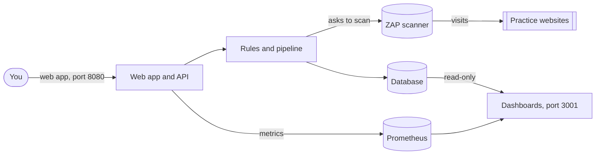
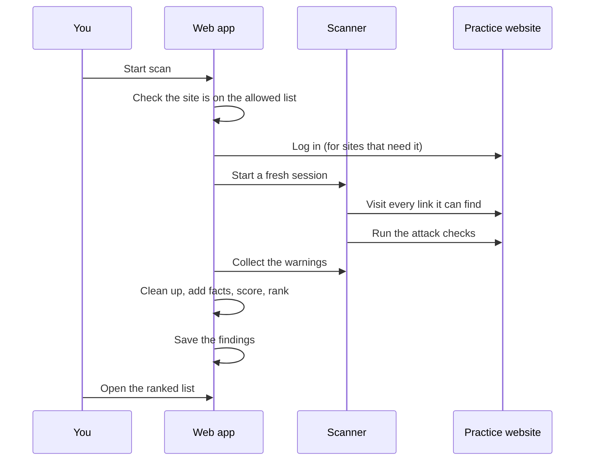

# How the system fits together

This page explains the parts of the system and how they talk to each other. You do not need to read the code to follow it.

## The parts

| Part | Where it lives | What it does |
|---|---|---|
| **Web app** | `src/web/` | The pages you click through: list targets, add a target, start a scan, see ranked findings |
| **Web API** | `src/api/app.py` | The same actions as the web app, for scripts |
| **Command line** | `src/cli.py` | The same actions from the terminal |
| **Services** | `src/service.py` | The rules: check the target is allowed, store records, run one scan at a time |
| **Scanner client** | `src/collectors/zap_client.py` | Tells the OWASP ZAP scanner what to do and collects the results |
| **Logins for practice sites** | `src/collectors/auth.py` | Logs in to the practice websites so the scanner can see the pages behind the login |
| **Clean-up** | `src/normalize/` | Turns the scanner's raw output into one common format |
| **Adding facts** | `src/enrich/` | Adds severity and exploit data from saved copies of public lists |
| **Scoring** | `src/scoring/` | Computes the risk score and the comparison scores (see [Scoring](SCORING.md)) |
| **Pipeline** | `src/pipeline.py` | Runs clean-up, adding facts, scoring and ranking in order. The web app, command line and experiments all use this |
| **Database** | `db/`, `src/db.py` | PostgreSQL stores targets, scans and findings |
| **Metrics** | `src/metrics/exporter.py` | Publishes numbers that Prometheus can read |
| **Dashboards** | `grafana/`, port 3001 | Charts and alerts, built from the metrics and the database |
| **Experiments** | `src/experiments/run.py` | Five experiments that compare the scoring methods, run from saved scan results |

## How data flows

In plain words:
- You use the web app to add a target and start a scan. Only the web app can start scans.
- The web app asks the scanner to visit the website, then saves the results in the database.
- Dashboards only read data. They cannot change anything or start scans.
- The scanner is only ever contacted by the web app, never directly by you or the dashboards.

## What happens during one scan

## Safety rules

- A scan only runs against sites listed in [TARGETS.md](TARGETS.md). The server checks this, not the browser.
- All services only accept connections from your own computer.
- Login details live in `.env`, which is not stored in git.
- The practice-site logins are the public default accounts of those apps, and they are only used inside the Docker network.
