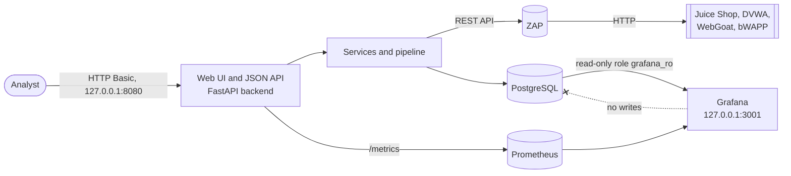
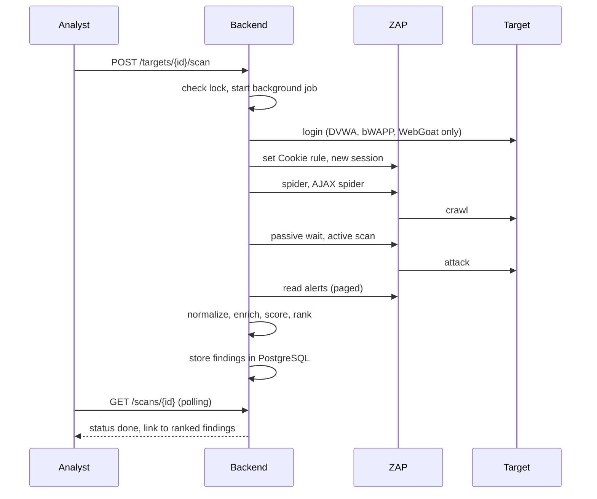

# Architecture

## Components

| Component | Where | What it does |
|---|---|---|
| Web UI (FastAPI + Jinja2) | `src/web/`, served by `backend` on 127.0.0.1:8080 | Target registration, scan start and status, ranked findings, baseline comparison, report links. Talks only to `src/service.py` |
| JSON API | `src/api/app.py` | Same operations as the UI, for scripts and the host CLI (`src/cli.py`) |
| Services | `src/service.py` | Allowlist check, target and scan records, background scan job, one-at-a-time ZAP lock |
| ZAP client | `src/collectors/zap_client.py` | New session, spider, AJAX spider, passive wait, active scan, alert paging. Sends a session cookie when a target needs login |
| Session seeding | `src/collectors/auth.py` | Logs in to DVWA, bWAPP and WebGoat from inside the Compose network |
| Normalization | `src/normalize/` | ZAP alert JSON to the internal Finding schema (CWE and OWASP mapping) |
| Enrichment | `src/enrich/` | CVSS, EPSS and KEV from the local feed snapshot, only where a CVE is mapped |
| Scoring | `src/scoring/` | Framework risk, three baselines, explanation text, rank comparison |
| Pipeline | `src/pipeline.py` | normalize, enrich, score, rank. The same code path for the UI, the CLI and the experiments |
| Storage | `db/migrations/`, `src/db.py` | PostgreSQL: targets, scans, findings, validation results. Read-only role for Grafana |
| Metrics | `src/metrics/exporter.py` | Prometheus collector that reads current state from PostgreSQL on every scrape |
| Grafana | `grafana/provisioning/`, 127.0.0.1:3001 | Dashboards and one alert rule, provisioned from files. Reads Prometheus and the read-only DB role |
| Experiments | `src/experiments/run.py` | Validation experiments 1–5, offline, from saved raw alerts |

## Two entry points, one-way data flow

- The analyst uses the web UI. It is the only place where targets are created and scans are started.
- Grafana is for monitoring and analysis. It reads Prometheus metrics and the findings tables through a read-only role. It cannot write to the database or start scans.
- Neither entry point talks to ZAP directly. Only the backend does.
- Data flows one way from the backend into each view: scans and findings go into PostgreSQL, the backend exposes metrics, and both views read from there.

## Scan sequence

## Trust boundaries

- Scan targets must be in `docs/TARGETS.md`. The check runs on the server, not in the browser.
- Every published port binds to 127.0.0.1. The backend's `/metrics` and `/healthz` have no login. They are reachable only from the host and the Compose network.
- Credentials live in `.env` (not committed). The seeded logins use the public default accounts of the training apps, only inside the Compose network.
