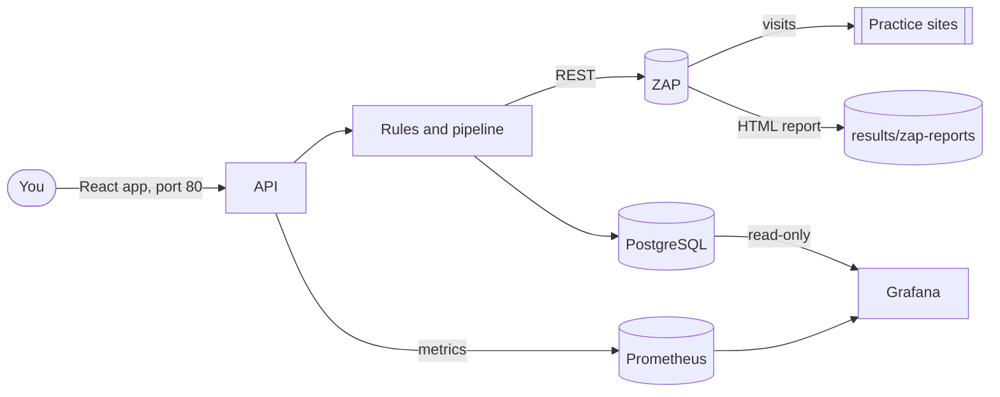

# How the system fits together

This page lists the parts and how they talk. It describes the code as it is now.

## The parts

| Part | Where it lives | What it does |
|---|---|---|
| React app | `frontend/`, port 80 | Targets, profiles, scan results, downloads, status panel. Built with Vite, served by nginx, which forwards `/api` |
| Original pages | `src/web/`, port 8080 | Server-rendered fallback pages |
| JSON API | `src/api/app.py` | Targets, scans, profiles, re-score, downloads, export and import, health |
| Rules | `src/service.py` | Allowlist, targets, scan start (memory check, profile validation), re-score, export, import |
| Scan profiles | `src/scanprofile.py`, `configs/scan_profiles.json` | Named profiles and validated custom settings |
| Scanner client | `src/collectors/zap_client.py` | Applies the profile to ZAP, runs spiders, passive wait, active scan, alerts, the ZAP HTML report |
| Logins and DVWA reset | `src/collectors/auth.py` | Logs in to the practice sites; resets DVWA before each scan |
| Clean-up | `src/normalize/` | One finding format with CWE and OWASP mapping |
| Triage | `src/triage.py` | Classification and grouping by fingerprint |
| Enrichment | `src/enrich/` | CVSS, EPSS, KEV from saved feeds, with provenance and n/a handling |
| Scoring | `src/scoring/` | Risk score, comparison scores, explanation, comparison metrics |
| Pipeline | `src/pipeline.py` | Clean-up, triage, enrichment, scoring and ranking, in that order |
| Reports | `src/report/` | Per-finding and full-scan HTML and JSON, with escaping |
| Import and export | `src/importexport.py` | Versioned format, validation, recomputed scores |
| Health | `src/health.py` | Postgres, ZAP and feed freshness |
| Database | `db/migrations/` (001 to 011), `src/db.py` | PostgreSQL; applied at backend startup. Read-only role for Grafana |
| Metrics | `src/metrics/exporter.py` | Prometheus collector, read from the database on each scrape |
| Dashboards | `grafana/` | Provisioned from files |
| Experiments | `src/experiments/run.py` | Experiments 1 to 7, JSON and CSV |
| Scripts | `scripts/` | export_scan, import_scan, sample_usage, check_bindings, gen_reproducibility |

## Data flow



Only the backend talks to ZAP. The dashboards only read. ZAP writes its HTML report to a folder that the backend also reads.

## One scan

```mermaid
sequenceDiagram
    participant U as You
    participant B as Backend
    participant Z as ZAP
    participant T as Site
    U->>B: start scan (profile or custom)
    B->>B: validate settings; check allowlist; check free memory
    B->>T: log in (DVWA: reset first)
    B->>Z: new session; apply settings
    B->>Z: spiders (as the profile says); passive wait; active scan
    Z->>T: crawl and attack
    B->>Z: read alerts (paged); generate HTML report
    B->>B: normalize, triage, enrich, score, rank
    B->>B: store findings, settings, timings, raw alerts, report name
    U->>B: open results
```

## Safety boundaries

- The allowlist (`docs/TARGETS.md`) is checked on the server for every scan and every import.
- Every published port is bound to `127.0.0.1`. `make up` refuses public ports in `AUTH_MODE=none`.
- Scan requests accept only the fields in `src/scanprofile.py`. Imports accept only the format in `src/importexport.py`.
- Credentials are in `.env`, not in git. Practice-site logins are the apps' public defaults and stay inside the Docker network.
